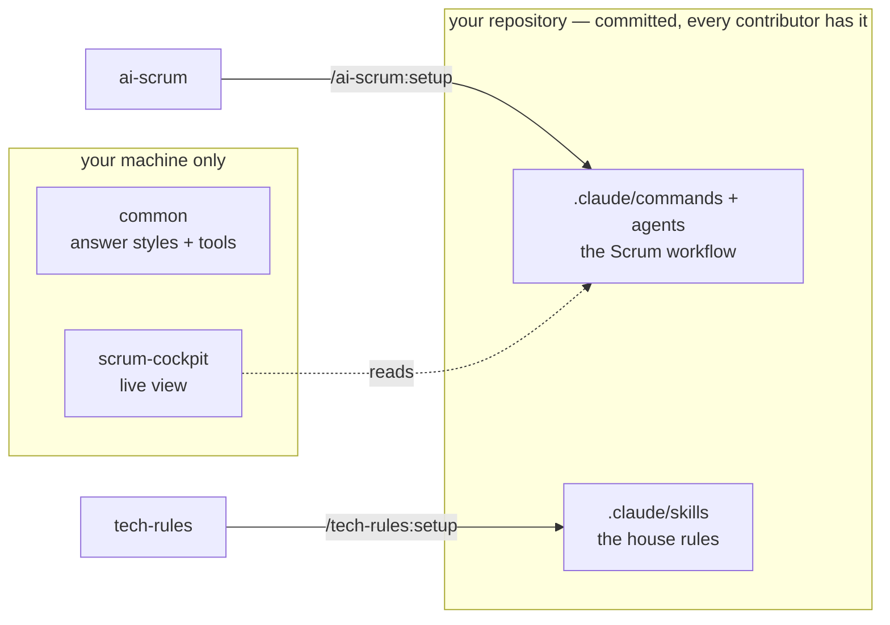

# Hantsch — Claude Code plugins

Four plugins for [Claude Code](https://claude.com/claude-code): a Scrum workflow, your stack's
house rules, a few everyday tools, and a live view of the workflow. Public — no token, no clone
needed to install.

## Which plugin do I need?

| You want … | Plugin | Start with | |
| --- | --- | --- | --- |
| to plan and build a product in sprints, with specs and reviewed stories | [ai-scrum](plugins/ai-scrum/) | `/ai-scrum:setup`, then `/concept` | [changes](plugins/ai-scrum/CHANGELOG.md) |
| Claude to follow your stack's rules (.NET, React, Electron, UI, tests) | [tech-rules](plugins/tech-rules/) | `/tech-rules:setup` — then it works by itself | [changes](plugins/tech-rules/CHANGELOG.md) |
| a shorter answer style, a premortem, a secrets scan or an architecture review | [common](plugins/common/) | `/config` → Output style, or `/common:…` | [changes](plugins/common/CHANGELOG.md) |
| to see your ai-scrum sprint beside the chat and start the next step with a click | [scrum-cockpit](plugins/scrum-cockpit/) | `/scrum` | [changes](plugins/scrum-cockpit/CHANGELOG.md) |

## How they fit together



- **ai-scrum** and **tech-rules** are *installers*: their setup command writes into the repository.
  Commit the result, and everyone who clones has the workflow and the rules — only whoever updates
  them needs the plugin.
- **common** and **scrum-cockpit** stay on your machine: they are tools for the person at the
  keyboard, not rules for the repository.

## Install

```
/plugin marketplace add Hantsch/claude                    # once per machine
claude plugin install <plugin>@hantsch --scope user       # each plugin you want
```

Always `--scope user`: the interactive `/plugin install` can land in project scope, which breaks
in VS Code ([why](docs/troubleshooting.md)).

**Update:**

```
/plugin marketplace update hantsch
/plugin update <plugin>
```

For ai-scrum and tech-rules, then run their setup again in each project and commit — that is what
brings the project's copy up to date. scrum-cockpit shows a hint with an **Update** button when a
project is behind.

## Something does not work?

**`Unknown command: /<plugin>:<command>`** — reinstall with `--scope user` and restart the session.
Typical in VS Code on Windows; the full diagnosis is in [docs/troubleshooting.md](docs/troubleshooting.md).

**Migrating from the old `dotnet`, `react` or `electron` plugins?** They are gone; their rules are
now part of tech-rules —
[four steps](plugins/tech-rules/REFERENCE.md#migrating-from-the-react-dotnet-and-electron-plugins).

## Contributing

Layout, adding a plugin, testing locally, how releases work: [CONTRIBUTING.md](CONTRIBUTING.md).
Versions live in [`.claude-plugin/marketplace.json`](.claude-plugin/marketplace.json), each
plugin's `plugin.json` and the [releases](../../releases) — never in a README.

## License

[MIT](LICENSE)
