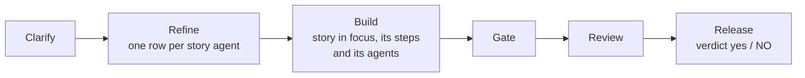

# scrum-cockpit

**See where your ai-scrum project stands — beside the chat, live — and start the next step with
one click.** A Claude Code *mod*: it changes Claude Code's own interface, not your project.

Needs [ai-scrum](../ai-scrum/) in the project. Runs in the terminal, the desktop app (local
sessions) and VS Code (extension ≥ 2.1.299).

## At a glance

**The band** — always above the prompt, one line:

```
✻ ▶ M3 Login · S14 Build 4/12 · 026 D4/5 · ● 2 agents · 6m        [Overview] [Hide]
⚠ tech debt 10/10 · architect review due (21 stories)
```

**The pane** — `/scrum` or **Overview**. Idle, it is one card; a button appears only where
something is due:

```
✻ ai-scrum 4.13.0 ✓
Stage      mvp · 1 advice  ▸
Phase      1 · The King moves in · 4/6 milestones
Release    not tracked (stage mvp)
Tech debt  7 / 10  ███████░░░
Architect  14 / 20  ███████░░░  stories since review (2026-10-12)
Backlog    23 open · 4 ready · 6 unplanned  ▸
Next       S10 planned · 5 stories                     [Start S10]
```

While a sprint runs, the pane follows it through its phases:



## What do I do when …

| You see … | It means | Press |
| --- | --- | --- |
| `Next S10 planned` | a sprint is ready | **Start S10** |
| `Next` with no sprint | nothing planned | **Plan next sprint** |
| a sprint, but no agent running | `/sprint` stopped | **Resume** |
| `⚠ ai-scrum in this project is 4.12, plugin is 4.13` | the project's copy is behind | **Update** (runs setup) |
| `⚠ … available: /plugin update` | the plugin itself is behind | nothing — run `/plugin update` yourself |
| `Tech debt` amber / red | debt near / at its limit | **Plan tech-debt cleanup** |
| `Architect … due` | enough stories since the last review | **Architect review** |
| an agent drawn amber, *quiet* | no tool call for 3 minutes | press it to read its transcript |
| `releasable: NO` (red) | the release check failed | open the log it names |

Every button runs exactly the command you could have typed, with that command's own model and
effort — the label shows them, e.g. `Build · sonnet/medium`.

## Commands

| Type | Opens |
| --- | --- |
| `/scrum` | the pane |
| `/scrum settings` | branching: base branch, sprint branch or direct commits, protected branches — saved to `.claude/ai-scrum.md` at once, locked while a sprint runs |

## Install

```
claude plugin install scrum-cockpit@hantsch --scope user
```

Active at once, no reload, nothing to set up.

## Good to know

- **Read-only, with one exception:** the settings pane writes the `## Branching` lines of
  `.claude/ai-scrum.md`. Everything else only reads.
- **It cannot update plugins.** `/plugin update` stays your step.
- **Design is not shown yet** — `/design-review` and the `## Design` profile keys have no row or
  button.

## Details

[REFERENCE.md](REFERENCE.md): every row, card and button, the settings pane, which file each
number comes from, how often it refreshes, and how to develop and test the mod.
