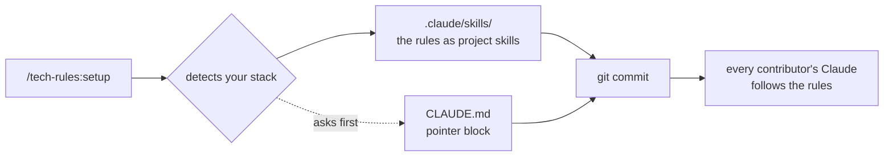
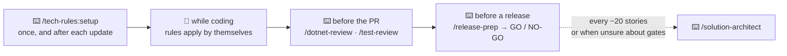

# tech-rules

**One command puts your stack's house rules into the repository** — so Claude follows them for
everyone who clones it, with nothing to install.



## When do I use what

Most rules work **by themselves** (🤖): Claude reads the rule when the task matches — you do
nothing. A few are **commands you type** (⌨️) when the moment comes.



| You want to … | Use | |
| --- | --- | --- |
| set a project up, or bring it to the latest rules | `/tech-rules:setup` | ⌨️ |
| know whether a project is behind (changes nothing) | `/tech-rules:setup check` | ⌨️ |
| write or change code | `karpathy` + your stack's rules | 🤖 |
| write, move or fix a test — or a test is red on CI but green locally | `test-gates` | 🤖 |
| build or change a screen | `design-system` | 🤖 |
| review a C# diff | `/dotnet-review [staged \| branch \| <path>]` | ⌨️ |
| clean up a slow or flaky test suite | `/test-review` → report: delete / merge / move / fix | ⌨️ |
| know whether you can release | `/release-prep` → report with GO / NO-GO | ⌨️ |
| decide which gates fit the project's stage (prototype → live) | `/solution-architect` | ⌨️ |

## What you get — by stack

Setup installs only what your project has. Everything here is a project skill in
`.claude/skills/`.

| Your project has … | You get |
| --- | --- |
| anything (always) | `karpathy`, `test-gates`, ⌨️ `test-review`, ⌨️ `release-prep`, ⌨️ `solution-architect` |
| a `*.sln` / `*.csproj` | `backend-guidelines`, `composition-root`, `csharp-unittest`, ⌨️ `dotnet-review` |
| `react` in a `package.json` | `frontend-guidelines`, `design-tokens` |
| `electron` | `electron-arch`, `typed-ipc`, `renderer-guidelines`, `ui-verify` |
| a user interface (web, desktop, .NET UI) | `design-system` |

One line per skill: [REFERENCE.md → What ships](REFERENCE.md#what-ships).

## Install — three steps

```
claude plugin install tech-rules@hantsch --scope user    # 1. once per machine (maintainer only)
/tech-rules:setup                                         # 2. in the project
git add .claude/skills .claude/tech-rules.lock CLAUDE.md  # 3. commit — only then everyone has it
```

**Update:** `/plugin update tech-rules`, run `/tech-rules:setup` again, commit. Contributors get
the rules by cloning, but updates only when someone does this.

## Three rules of thumb

- **Never edit an installed skill.** The next update overwrites it or stops to ask. A project that
  deviates says so in its own `CLAUDE.md`, with the reason.
- **Skills advise, they do not enforce.** Only a lint rule, a test or a hook stops a violation.
- **Commit what setup writes.** Uncommitted, the rules exist only on your machine.

## Details

[REFERENCE.md](REFERENCE.md): why the rules live in the repository and not in a plugin, every skill
in one line, what setup writes and never touches, what happens to an edited copy on update, what is
actually enforced, project deviations, and migrating from the old `react`, `dotnet` and `electron`
plugins.
